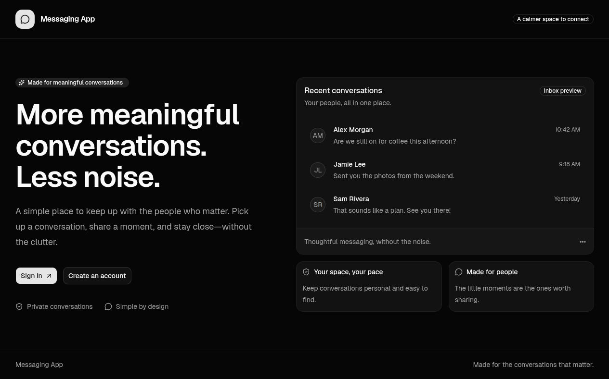
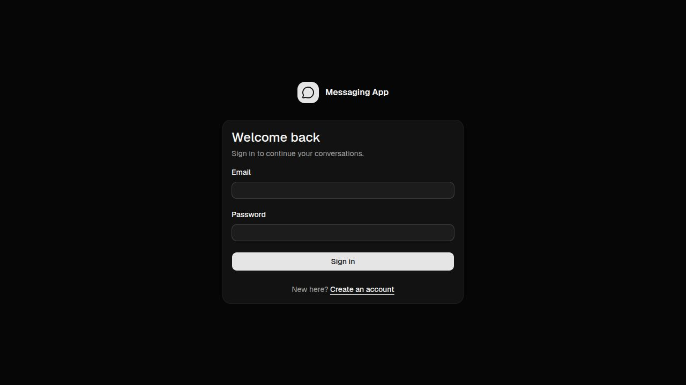

# Messaging App

A full-stack messaging application for one-to-one conversations. Create an account, find other people, and keep your conversations in one place.

**[Open the live application](https://messaging-app-client.carlosaac232001.workers.dev/)**

## Preview





The conversations on the home page are examples; sign in to access your own inbox.

## Features

- Register, sign in, and maintain a cookie-based session.
- Search for people and start or continue a one-to-one conversation.
- Send text messages and check for new messages automatically while the app is open.
- Edit your display name and bio.
- Use the app on desktop and mobile screens.

## Built With

- **Frontend:** React, TypeScript, Vite, Zustand, React Router, Tailwind CSS, shadcn/ui, and Base UI.
- **Backend:** Node.js, Express, TypeScript, Zod, and express-session.
- **Database:** PostgreSQL and Prisma.
- **Deployment:** Cloudflare Workers for the client and Render for the API.

## Project Structure

- `client/` — React, TypeScript, and Vite frontend.
- `server/` — Express API, Prisma schema, and PostgreSQL migrations.
- `server/bruno/` — Bruno requests for checking API endpoints.

## Requirements

- Node.js and pnpm (the server specifies pnpm 12.21.0).
- PostgreSQL database.

## Local Development

Configure the API first:

```sh
cd server
cp .env.example .env
```

Edit `server/.env` with a PostgreSQL `DATABASE_URL` and a long random `SESSION_SECRET`. Then install dependencies, generate Prisma client, apply the development migration, and start the API:

```sh
pnpm install
pnpm db:generate
pnpm db:migrate
pnpm dev
```

In another terminal, start the frontend:

```sh
cd client
pnpm install
pnpm dev
```

The API defaults to `http://localhost:4000` and the Vite client to `http://localhost:3000`. Set `CLIENT_ORIGIN` in `server/.env` to the client origin if it differs from the default.

## Useful Commands

Run these from `client/` or `server/` as appropriate:

- `pnpm build` — build the package.
- `pnpm lint` — run Oxlint.
- `pnpm fmt:check` — check server formatting.

See [server/README.md](server/README.md) for API routes and deployment notes. No automated unit-test command is configured yet.
